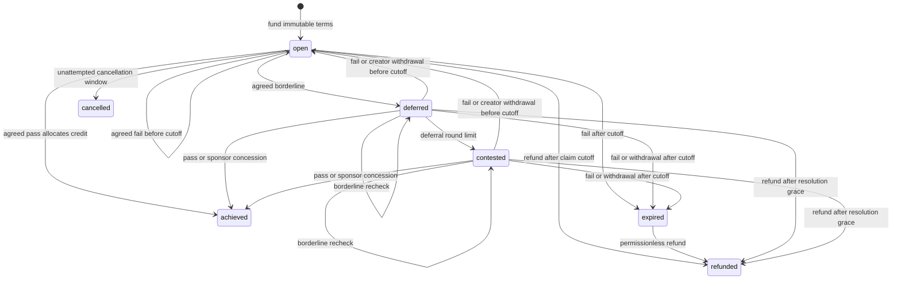

# Content Milestone Oracle

A GenLayer intelligent contract for escrowed creator rewards. A sponsor funds a
milestone with an immutable URL, metric, threshold and reader. The creator files
a claim by its deadline. Validators independently fetch the source, interpret
the displayed count and bind the same settlement zone before allocating money.

**The deadline is a claim-filing cutoff.** A timely borderline claim can achieve
its threshold later during the disclosed resolution grace. This contract reads
current content; it does not prove historical achievement by a past date.

This repository is a contract primitive with a durable integration client and a
runnable grant wrapper. It does not include a hosted backend or a frontend.

## Architecture

| Component | Responsibility |
| --- | --- |
| `contracts/content_milestone_oracle.py` | Escrow, immutable terms, independent observations, consensus, credit allocation, receipt verification |
| `scripts/milestone_client.py` | Durable submission journal, stored appeal polling, authoritative ruling refresh, rechecks/refunds and withdrawal confirmation |
| `contracts/grant_programme.py` | Owner-managed IC sponsorship, phased funding/creation and internal credit withdrawal |
| External source | Public displayed count; every participating validator fetches it independently |
| Application | Source selection, presentation, authentication, notifications and indexing |

Both deployable contracts pin GenVM runner
`py-genlayer:1jb45aa8ynh2a9c9xn3b7qqh8sm5q93hwfp7jqmwsfhh8jpz09h6`.
Direct tests load the corresponding v0.2.16 SDK. Dependencies are pinned in
[`requirements.txt`](requirements.txt).

## Consensus and settlement

The nondeterministic leader and validators each fetch the source and perform the
same deterministic scan. A model selects the relevant count from that scan;
source content is explicitly untrusted and cannot supply instructions. The
contract rejects a value absent from the exact canonical metric candidates.
Nearby unrelated metric labels invalidate ambiguous associations. Fetch mode,
wait duration, metric keywords and scoping keywords are fixed at funding.

A successful observation has exactly five fields:

```json
{"found": true, "value": 12400, "lower": 12350, "upper": 12499, "zone": "borderline"}
```

`value` is a representative displayed count, not a precisely agreed historical
fact. Integer displays have identical lower/upper bounds. Abbreviations have
conservative precision intervals covering rounding and truncation: `12.4K`
means a nominal 12,400 and bounds 12,350–12,499. Invalid fractional count
expansions and ambiguous grouping-versus-decimal abbreviations (e.g. `1.234K`)
are rejected. If interval endpoints have different zones, the
observation is borderline. An unreadable observation must have `found=false`,
`value=lower=upper=0` and `zone=unreadable`.

For threshold `T` and band `B = floor(T * band_bps / 10000)`:

| Zone | Exact-count condition | Effect |
| --- | --- | --- |
| pass | `value >= T + B` | Allocate fixed creator and fee credits |
| fail | `value < T - B` | Reopen before claim cutoff, otherwise expire |
| borderline | Between those lines, or precision spans zones | Schedule a recheck |
| unreadable | Source fetched but requested count not established | Record the failed observation; reopen before cutoff or expire afterward |

The validator enforces strict field types, recomputes the leader's zone from its
bounds, checks nominal and bound differences against the combined numerical
allowance, and **requires the leader's zone to equal its own independently
computed zone**. For each reading `v`, the allowance is
`max(variance_floor, floor(v * variance_bps / 10000))`. Numerical proximity never
permits a different payout outcome. At a threshold of 10,000 with the default
band, 10,100 versus 10,099 is rejected in both leader orders even though the
readings differ by only one.

Payouts depend exclusively on the agreed zone and immutable reward/fee terms.
They never depend on the leader's raw count or a free-form model explanation.
A pass allocates `reward - floor(reward * fee_bps / 10000)` to the creator and
the fee to its fixed recipient. There are no partial-score payouts.

Evidence contains the bound observation, deterministic display/explanation,
reader snapshot/hash, round and transaction timestamp. The model's narrative is
not stored as verified evidence or binding precedent. `get_evidence` returns the
latest JSON record; `list_evidence` retains the observation history. The time
field identifies the transaction timestamp, not the browser's fetch time.
Downstream financial decisions must consume the agreed zone, not reinterpret a
representative count as an exact fact.

## Milestone lifecycle



Only the creator can submit or withdraw a claim. Rechecks and refunds are
permissionless; refunds always credit the recorded sponsor. A sponsor can
concede a pending claim, explicitly authorizing its fixed reward even when the
oracle remains uncertain. Concession is a sponsor decision, not a fabricated
validator pass. A sponsor can cancel only an open, never-adjudicated milestone
within its fixed creation window.

Default recheck delay is six hours. The fourth borderline round becomes
contested; contested cases can still be rechecked until their resolution grace
ends. Grace is two days after the claim-filing deadline. Neither a deferral nor
an API error extends that fixed grace. `is_claimable`, `is_resolvable` and
`is_refundable` report current eligibility and its reason. Timestamp fields are
conditional: an open/terminal case need not have `recheck_after`. Eligibility
windows use the consensus transaction timestamp. A delayed or replayed
execution can fetch content after the corresponding wall-clock window; neither
the deadline nor grace proves when the underlying metric was achieved.
`achievement_time_semantics` explicitly reports current content at execution
without a historical cutoff guarantee.

Terms fixed at creation include URL/platform/metric, threshold, band/variance,
reader configuration, effective fee rate/recipient, recheck delay, round limit,
grace and cancellation window. Owner registry or default changes affect future
milestones. Disabling a platform blocks new funding; it leaves existing reader
snapshots intact. The owner can pause creation, top-ups, claims and rechecks;
cancellation, concession, claim withdrawal, eligible refunds, credit withdrawal
and receipt recovery remain available. Owner pause authority is a disclosed
availability risk, bounded by the refund deadlines.

## Deposits, credits and payments

Studio can credit attached native value even when GenVM execution fails. The
contract therefore separates native credit ownership from adjudication and
outbound transfer completion.

1. `deposit()` is an unconditional payable call that credits its immediate
   sender. `create_from_credit(...)` consumes that sender's existing credit only
   after all deterministic milestone guards pass.
2. Payable `create_milestone(...)` returns a milestone ID on success. An expected
   admission rejection with positive attached value returns
   `{"status":"rejected","reason":"...","credit_atto":...}` and records
   the full amount as sender-owned credit. `top_up` uses the same rejection
   policy. A successful transaction receipt alone is insufficient to establish
   that creation succeeded: inspect the returned result and chain state.
3. A pass, concession, refund or cancellation allocates beneficiary credit.
   `achieved` and `payment_status=credit_allocated` describe entitlement. They
   do not mean that a transfer completed. Credits are fungible per beneficiary;
   payment tickets are separate from individual milestones.
4. The credit owner calls `withdraw_credit(to, amount, recipient_kind)`.
   `eoa` queues a native chain-layer transfer. `ic` emits a finalized internal
   call to the recipient's **payable `receive_payment()`** method. The owner
   chooses the recipient and message layer. Arbitrary IC recipients without
   that callback are not a supported application integration.
5. The withdrawal debits credit once and creates a `queued` ticket. Wait for
   the parent and its child to finalize, then call
   `confirm_payment(payment_id, parent_transaction_id)`. Every validator
   independently checks the immutable receipt RPC, finalized status, successful
   parent return, exact stored ticket, sender/recipient/value and child-parent
   relationship. This cannot re-send a transfer.
6. `delivered` means the child reports native value credited. For IC recipients,
   also check `recipient_execution` and `application_status`: native delivery
   can coexist with rejected application execution. A rejected IC callback does
   not create a second refundable oracle credit for already credited funds.
7. A proven uncredited child becomes `failed`. `restore_failed_payment` restores
   credit once from that ticket's still-held reserve or the protected
   `fund_recovery()` donation pool. Unallocated balance may belong to another
   failed depositor and is never treated as a withdrawal refund. If the runtime
   already debited the source, explicit recovery funding is required; an
   unattributed balance increase does not prove its return. Donations create no
   donor credit and are not a guaranteed network refund.

If a true VM/argument-decoding fault prevents any deposit ledger update, its
original sender can call `recover_failed_deposit(transaction_id)`. Validators
independently require a finalized failed execution to this contract with
positive native value credited to it and the exact original sender. Recovery
is once per hash and requires available backing. Successful calls and
uncredited, pending, foreign or replayed deposits do not qualify.

The receipt RPC is an immutable constructor parameter disclosed by
`get_config`. The supported public deployment uses hosted Studio's receipt
format and `https://studio.genlayer.com/api`. Receipt recovery depends on that
endpoint's availability and correctness; it is independent consensus over RPC
responses, **not a cryptographic light-client proof**. A deployment on another
network needs a verified compatible receipt provider and network tests.

`get_treasury` distinguishes unresolved escrow, beneficiary credits, queued
transfers, held native reservations, protected recovery donations and confirmed
native disbursement. Liabilities include the recovery pool; failed-deposit
recovery cannot turn those earmarked donations into an unrelated sender credit.
`total_paid_atto`, `total_refunded_atto` and `total_fees_atto` are allocation
totals for compatibility; `total_disbursed_atto` counts confirmed native credit.
`surplus_atto` is unallocated recoverable balance, not owner income.
`withdraw_surplus` is permanently disabled to preserve the ownership of native
credits whose originating execution failed before updating storage.

## Sources and platform registry

A preset is a reader configuration, not a promise that every page will be
readable. Sponsors must inspect the source and fixed reader before funding.

| Preset | Metrics | Reader and verification scope |
| --- | --- | --- |
| `github` | stars, forks, watchers, contributors, issues | Rendered text on `github.com`, four-second wait for asynchronous sidebar counts; live consensus tests exercise these metrics |
| `npm` | downloads | HTTP GET; use the official public downloads API, e.g. `https://api.npmjs.org/downloads/point/last-week/react` |
| `youtube` | views, likes, subscribers, comments | Experimental rendered-text preset, four-second wait; no live availability guarantee |
| `x` | likes, reposts, views, followers, comments | Experimental rendered-text preset, five-second wait; login/anti-bot restrictions may prevent readings |
| `generic_web` | Registered default metrics | Experimental arbitrary-HTTPS rendered reader; a sponsor-selected page is not authenticated platform truth |

The owner can register custom platform/metric configurations. Host entries
match exact hosts or subdomains; `*` allows arbitrary HTTPS hosts. HTTPS/host
validation does not establish ownership, authenticate page assertions or prevent
redirects to different content. Public dynamic pages can change, disappear,
require login or display unrelated counters. Models and label adjacency reduce
wrong-count selection; they cannot authenticate a dishonest publisher or
eliminate all semantic ambiguity. Unreadable pages do not become zero-count
claims or automatic payouts. A source failure cannot prevent eventual refund.

The scanner bounds processing to 400,000 source characters, 6,000 scoped
characters and 96 candidates. Grouped integers and K/M/B abbreviations are
supported; inferred hidden precision, estimated counts and values absent from
the source are rejected. English metric labels are the initial defaults;
owner-defined synonyms can extend future reader snapshots.

## Run and integrate

Install Python 3.12+ dependencies and the GenLayer CLI:

```bash
python3 -m pip install -r requirements.txt
npm install -g genlayer
```

Put `DEPLOYER_PRIVATE_KEY` in your environment or ignored `.env`. Never commit a
key or put it in a recovery journal. Studio transactions are gasless, but native
escrow deposits still require funded accounts.

Preflight with `check_url`, `get_platform`, `resolve_keywords` and `get_config`.
Submit creation once, retain its transaction ID, wait for successful finalized
execution and inspect its returned ID or rejection. Read `get_milestone` before
presenting success. All arguments after `deadline_ts` on `create_milestone` are
optional: `memo=""`, `band_bps=variance_bps=variance_floor=0`. For these three
consensus overrides, `0` uses defaults and `-1` explicitly requests zero.

The durable driver is executable and importable:

```python
from scripts.milestone_client import MilestoneDriver

# client is a configured genlayer_py client with its local account.
# The journal contains public metadata and is atomically updated.
driver = MilestoneDriver(client, oracle_address, "artifacts/my-operations.json")
driver.submit("create-1", "create_milestone", [creator, url, "github", "stars",
    5000, deadline_ts, "Grant", 0, 0, 0], value=10**15)
created = driver.wait("create-1")
if created["stage"] == "confirmed":
    milestone_id = created["result"]
    driver.submit("claim-1", "submit_claim", [milestone_id], milestone_id=milestone_id)
    claimed = driver.wait("claim-1")
# Creator's configured client performs its own credit withdrawal.
# driver.withdraw("withdraw-1", recipient, amount, recipient_kind="eoa")
```

A restarted driver polls stored IDs and refreshes `get_milestone` from finalized
chain state. Accepted allocations remain provisional until finalization; the
[protocol can recompute dependent transactions after an appeal](https://docs.genlayer.com/understand-genlayer-protocol/core-concepts/optimistic-democracy/finality).
All outbound payments in this project are emitted on finalization. Attach an
**already submitted** network appeal with
`driver.attach_appeal(operation, appeal_tx_id)`. Polling waits for that stored
appeal, including when its receipt is temporarily absent, then refreshes the
ruling and leaves the appealed state. Network appeals use GenLayer's consensus
mechanism; the contract does not implement a separate appeal tribunal.

```bash
python3 scripts/milestone_client.py ADDRESS --milestone m1 --journal artifacts/client.json
python3 scripts/milestone_client.py ADDRESS --resume claim-1 --appeal-id APPEAL_TX --journal artifacts/client.json
python3 scripts/milestone_client.py ADDRESS --withdraw-to RECIPIENT --amount 1000000000000000 --operation withdraw-1 --journal artifacts/client.json
```

Use the original withdrawal arguments and operation name to resume its whole
child/confirmation sequence. `--resume` alone polls that operation. Journals
bind sender, arguments and value. A lost submission response is ambiguous:
identify the original transaction and record its ID before continuing; the
client refuses to automatically re-send it. Changing a saved intent is refused.
Transport/polling errors retain IDs for safe recovery.

A later explicit invocation can retry a finalized failed confirmation, eligible
recheck or refund under a new recorded retry name. It first refreshes chain
eligibility or the payment ticket. This never resubmits a withdrawal/deposit or
an operation whose submission remains ambiguous.

The runnable [`GrantProgramme`](contracts/grant_programme.py) follows the same
rules. Deploy it with the oracle address, call payable `fund_oracle`, and wait
for its finalized `deposit` child. Then its owner can `create_grant` from its
oracle credit. Inspect the finalized creation child for the milestone ID. After
cancellation/refund, credit belongs to the programme; `withdraw_budget` directs
it to an EOA or an IC implementing `receive_payment()`. Wait for the wrapper
parent, oracle withdrawal child and recipient grandchild; anyone can confirm
the ticket using the **oracle withdrawal transaction ID**. `earned` means the
milestone is achieved, not that money was received. `fund_oracle` is an explicit
programme donation with no donor withdrawal entitlement.

Native refunds received by the programme can be reused through the owner-only
`redeposit_budget(amount_atto)`. Wait for its finalized oracle deposit child,
then create another grant or redeem the credit to an EOA. `budget` distinguishes
current native balance, oracle credit and lifetime native receipts; received
funds do not become trapped in a callback-only balance.

If its finalized oracle deposit child fails after crediting native value, the
owner calls `recover_oracle_deposit(child_transaction_id)`. The programme must
forward this recovery because it, rather than the owner's EOA, is the original
depositor. Inspect that recovery child, then withdraw the restored programme
budget through the ordinary ticket lifecycle.

## API reference

| Writes | Purpose |
| --- | --- |
| `deposit()` payable | Add sender credit unconditionally |
| `create_milestone(creator, content_url, platform_key, metric, threshold, deadline_ts, memo="", band_bps=0, variance_bps=0, variance_floor=0)` payable | Create, or return rejection and sender credit |
| `create_from_credit(creator, content_url, platform_key, metric, threshold, deadline_ts, reward_atto, memo="", band_bps=0, variance_bps=0, variance_floor=0)` | Create from existing sender credit |
| `top_up(milestone_id)` payable | Sponsor adds reward, or gets rejection credit |
| `cancel_milestone(milestone_id)` | Sponsor cancels unattempted open case within window |
| `submit_claim(milestone_id)` | Creator triggers independent adjudication |
| `withdraw_claim(milestone_id)` | Creator drops pending claim |
| `resolve_deferred(milestone_id)` | Permissionless eligible recheck |
| `concede(milestone_id)` | Sponsor authorizes fixed reward on pending case |
| `refund(milestone_id)` | Permissionless eligible sponsor credit allocation |
| `withdraw_credit(to, amount_atto, recipient_kind="eoa")` | Credit owner queues one transfer and gets ticket |
| `confirm_payment(payment_id, transaction_id)` | Verify finalized withdrawal parent/child and record native outcome |
| `restore_failed_payment(payment_id)` | Restore failed uncredited ticket from its reserve or explicit recovery donation pool |
| `recover_failed_deposit(transaction_id)` | Original sender recovers credited finalized VM-fault deposit once |
| `fund_recovery()` payable | Voluntary recovery donation |

| Owner writes | Authority |
| --- | --- |
| `transfer_ownership(new_owner)` | Change administration |
| `set_paused(flag)` | Pause admissions/adjudication; leave exits available |
| `set_consensus_params(band_bps, variance_bps, variance_floor, defer_seconds, max_defer_rounds, resolution_grace_seconds)` | Future milestone defaults |
| `set_economics(min_reward_atto, max_deadline_horizon, cancel_window_seconds)` | Future funding terms |
| `set_fee(fee_bps, fee_recipient)` | Lower nominal rate only; change future recipient |
| `register_platform(key, label, metrics, hosts, fetch_mode, wait_after_loaded, extra_keywords)` | Future reader registry; CSV list inputs |
| `set_platform_enabled(key, enabled)` | Future admission availability |
| `set_metric_keywords(metric, keywords)` | Future metric synonyms |
| `withdraw_surplus(to, amount_atto)` | Always rejects; no owner balance sweep |

Views: `get_owner`, `is_paused`, `get_config`, `get_milestone`, `get_evidence`,
`list_evidence`, `milestone_count`, `list_milestones`, `list_by_sponsor`,
`list_by_creator`, `count_by_sponsor`, `count_by_creator`, `get_status_counts`,
`get_platform`, `list_platforms`, `get_metric_keywords`, `list_metrics`,
`resolve_keywords`, `get_treasury`, `credit_of`, `get_payment`, `check_url`,
`classify_value`, `preview_agreement`, `preview_error_agreement`, `is_claimable`,
`is_resolvable`, `is_refundable`, `now_ts`. Milestone pagination takes
`offset, limit` and caps at 50. `list_evidence` defaults to `offset=0, limit=20`
and caps at 50. `classify_value` and `preview_agreement` inspect exact point
readings; actual adjudication additionally binds displayed precision bounds.

Errors are classified for consensus: `[EXPECTED]` compares identical messages;
transient web failures compare by class and preserve state; external/unreadable
conditions are handled conservatively; malformed or fabricated model responses
use `[LLM_ERROR]` and force rotation rather than accepting an agreement on an
unverified result. See `preview_error_agreement` and regression tests for the
specific comparison behavior.

## Defaults, tests and deployment

The constructor exposes 12 parameters, in this order:

| Parameter | Default |
| --- | --- |
| fee_bps / fee_recipient | `0` / empty, fee disabled |
| default_band_bps | `100` |
| default_variance_bps / default_variance_floor | `50` / `5` |
| defer_seconds / max_defer_rounds | `21600` / `4` |
| resolution_grace_seconds | `172800` |
| cancel_window_seconds | `3600` |
| min_reward_atto | `0` (funding still must be positive) |
| max_deadline_horizon | `31536000` |
| receipt_rpc | `https://studio.genlayer.com/api` |

```bash
genvm-lint check contracts/content_milestone_oracle.py
genvm-lint check contracts/grant_programme.py
pytest -p no:gltest tests/direct -q
pytest -p no:gltest -p no:gltest_direct tests/harness -q
gltest tests/integration -v -s --network studionet
python3 scripts/deploy_studionet.py --smoke-test --record artifacts/new-deployment.json
# Resume the same deployment IDs after interruption:
python3 scripts/deploy_studionet.py --resume --smoke-test --record artifacts/new-deployment.json
```

Direct tests cover boundary consensus, precision, malicious/malformed evidence,
fixed economics/readers, all lifecycle guards, fee allocation, deposit recovery,
receipt matching, replay protection and backed failure recovery. Offline client
tests exercise saved appeals, finalized ruling refresh, execution failures,
ambiguous submissions and restart behavior. Live integration tests require
validator votes and verify real sources, parent/child execution, balances,
rejected deposits, VM-fault recovery and IC composition. They use short timing
terms; the production deployment smoke test verifies production defaults.

GitHub Actions runs both contract linters and direct/offline suites. Live tests
are explicit funded network operations; they are not implied by a green offline
CI run. Logs and public transaction recovery journals live in ignored
`artifacts/`. GenLayer's transient test cache is separate so it cannot erase
those recovery records. The ignored root `TASKS.md` is the durable work checklist.

Deployment identifiers and final validation evidence are recorded in
[`docs/VERIFICATION.md`](docs/VERIFICATION.md). The verified replacement is
`0xA7D8Ef332de26346ca3f15E21558B500Afe424Be` on hosted StudioNet.
The [audit and remediation report](docs/AUDIT.md) records the discovered defects
and their fixes. The previous deployment
`0x555a04bDB15aa8E9972ad8EbA65236A3e4f7Ef36` contains the audited behavior and
is superseded; use the verified replacement address. Existing immutable
contracts do not receive these source fixes automatically.

This implementation is tested against the named Studio deployment and sources.
It cannot promise third-party source availability, inference infallibility,
atomic success across asynchronous IC messages, historical counts or acceptance
by every possible reviewer. Those boundaries are part of its public contract.
